# AutoDeploy

**English** | [Română](README.ro.md)

A deploy tool for Laravel projects on your own servers (DigitalOcean or any Linux box with SSH), in the
spirit of Envoyer / DeployBot. It is built for servers with little RAM: the front-end build
(`npm run build`) can run on your PC and only the result is uploaded to the server. After a RAM upgrade
you move the build to the server with one setting.

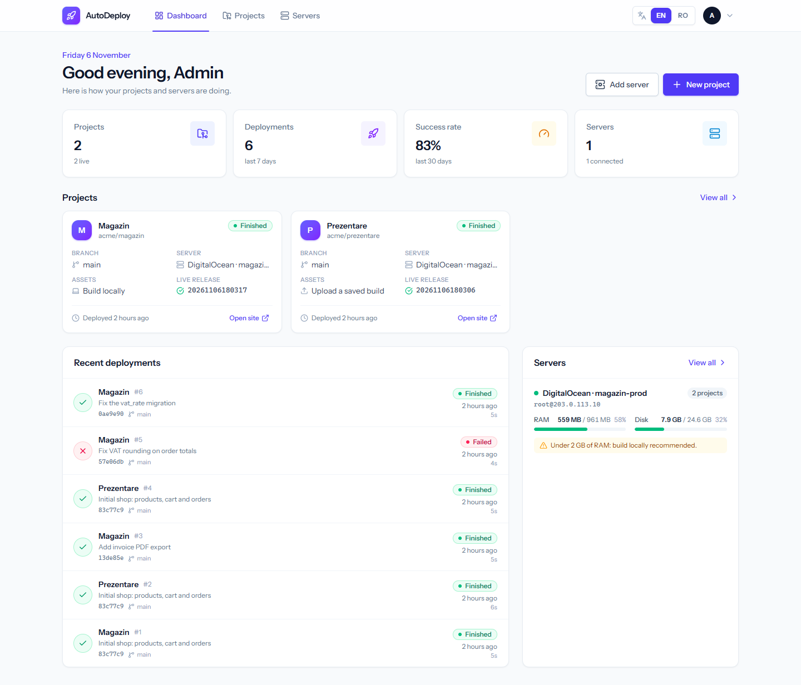

## Contents

- [What it does](#what-it-does)
- [Screenshots](#screenshots)
- [Requirements](#requirements)
- [Installation](#installation)
- [Configuration](#configuration)
- [First deploy, step by step](#first-deploy-step-by-step)
- [Layout on the server](#layout-on-the-server)
- [Useful commands and tests](#useful-commands-and-tests)
- [Full documentation](#full-documentation)

## What it does

- **Zero-downtime deploys** – every deploy goes into a new `releases/<date-time>` folder, `.env` and
  `storage` are shared in `shared/`, and the switch to the new version is instant through the `current`
  link. If a step fails, the live site stays untouched on the previous version.
- **3 ways to get the front-end assets**, chosen per project and at every deploy:
    - **Build locally** – AutoDeploy runs `npm run build` in the project folder on your PC and uploads the result
      (the folder must be committed and pushed: uncommitted changes or an unpushed commit stop the deploy);
    - **Saved build** – you upload a `.zip` of `public/build` made earlier; the newest N are kept;
    - **Build on the server** – `npm ci && npm run build` on the server (after a RAM upgrade).
- **Rollback** in one click to any of the last N releases (3 by default).
- **Custom commands** (Laravel, npm, bash) at three points of the deploy, with presets: migrations,
  `storage:link`, `optimize`, `queue:restart`, PHP-FPM reload, Horizon, Filament and more.
- **Live log** for every step, cancel, redeploy, health check, deploy on `git push` (GitHub webhook).
- **Queue workers (Supervisor)** and the **scheduler (cron)** set up with a single button.
- **Quick setup** of a project on its server: checks + import of `.env` and `storage` from an existing site.
- **`.env` editor** right on the server, server info (RAM, disk, versions), SSH key for GitHub.
- **Apache or Nginx** – the web server is detected and the matching config is shown.
- Interface in **English and Romanian** – pick the language in the top bar (English by default).

**Stack:** Laravel 13 · Inertia 3 · Vue 3.5 + TypeScript · Tailwind CSS 4 · Wayfinder · phpseclib 3
(SSH/SFTP in pure PHP, works on Windows too) · Pest 5 · SQLite.

## Screenshots

The screenshots use demo data (example server and projects).

|                    Project page                    |                   Deploy options                   |
| :------------------------------------------------: | :------------------------------------------------: |
|       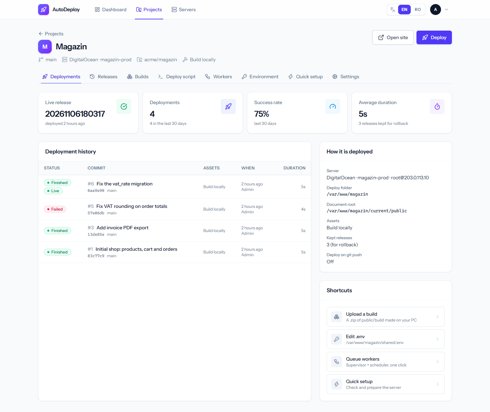       |    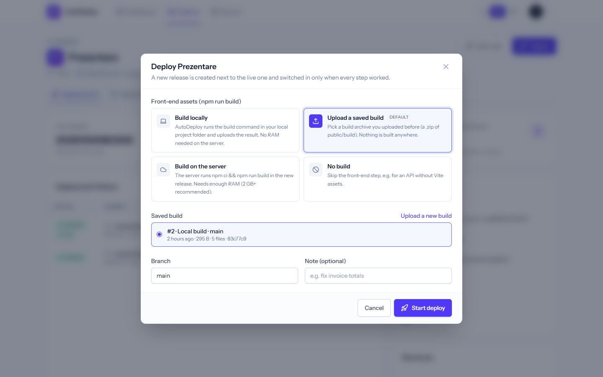    |
|              **Deploy with live log**              | **Deploy stopped at a migration – site untouched** |
|    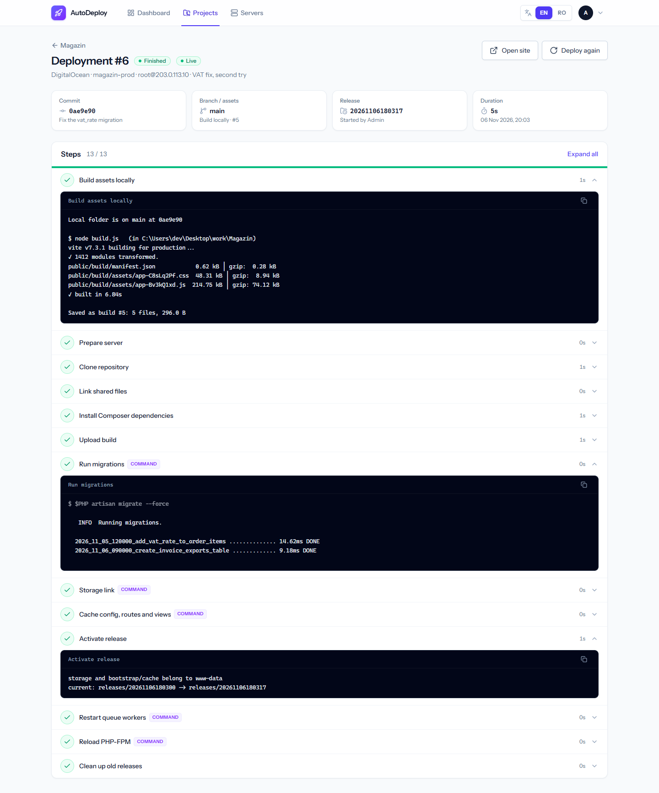    | 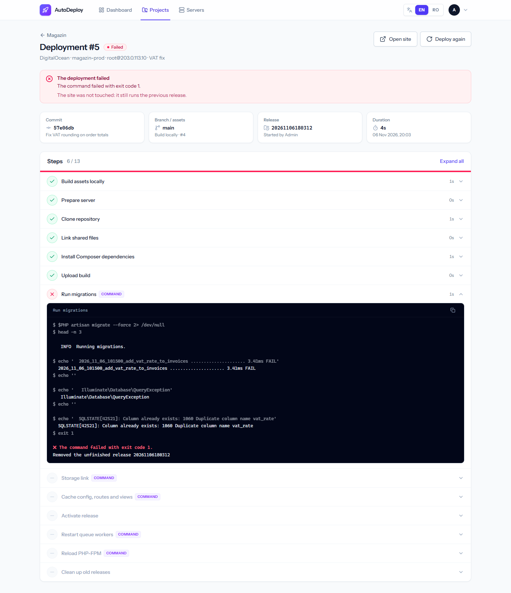 |
|        **Deploy script (custom commands)**         |          **Queue workers and scheduler**           |
| 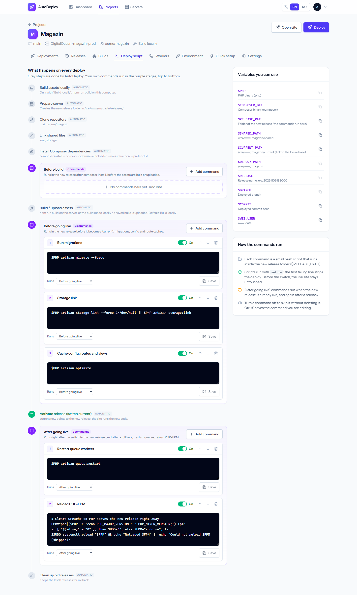 |       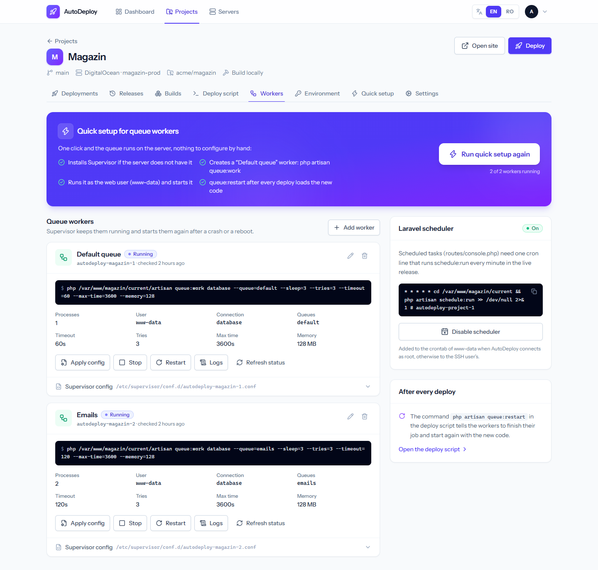       |
|             **Releases and rollback**              |             **Saved builds (upload)**              |
|      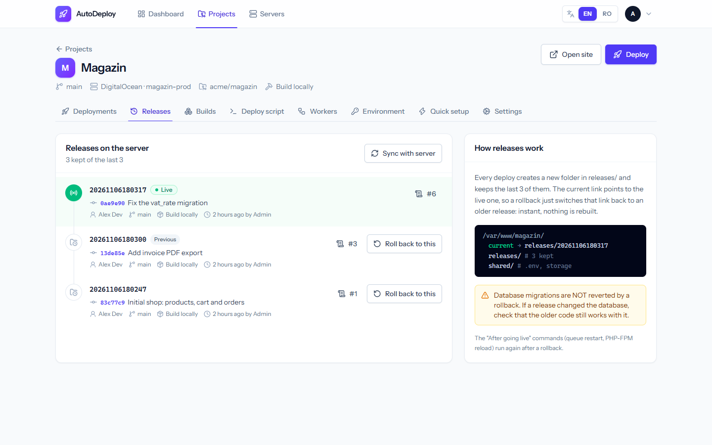      |        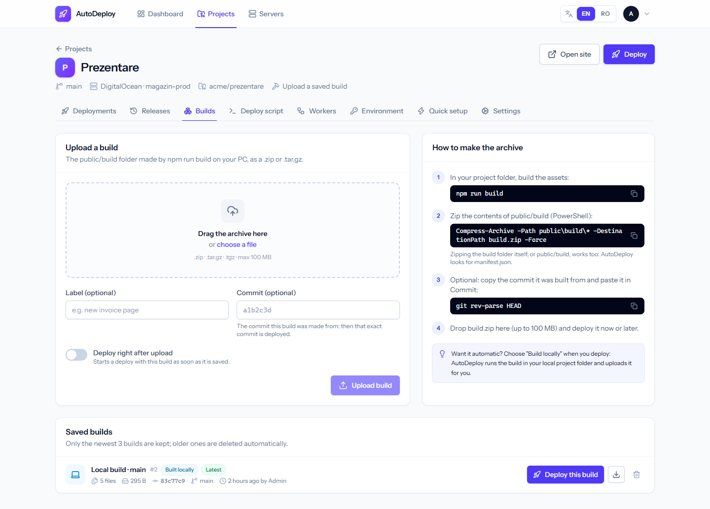        |
|       **Server: RAM, disk, software, keys**        |                     **Login**                      |
|        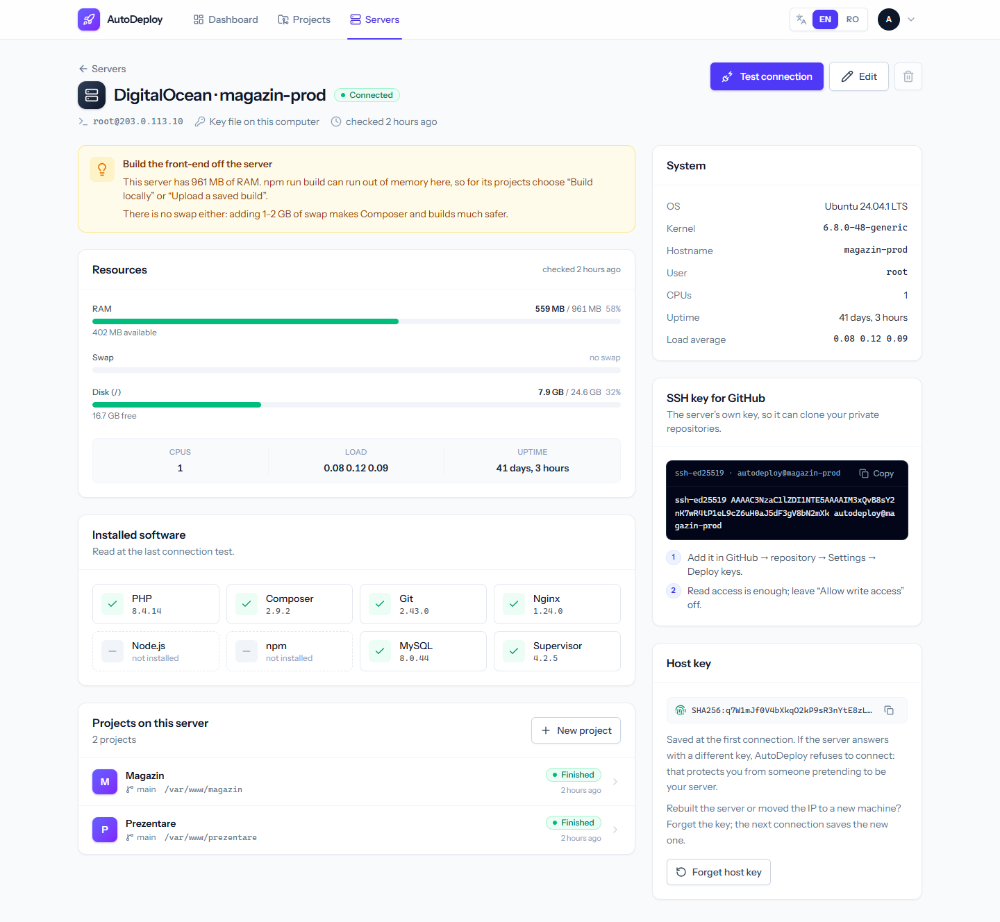        |         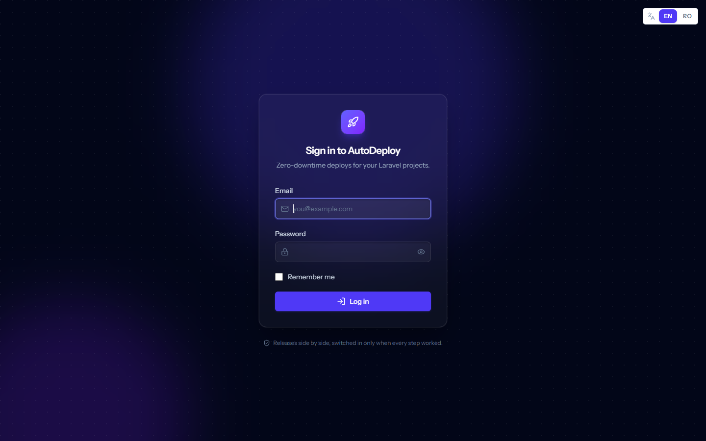         |

On a phone:

<p>
  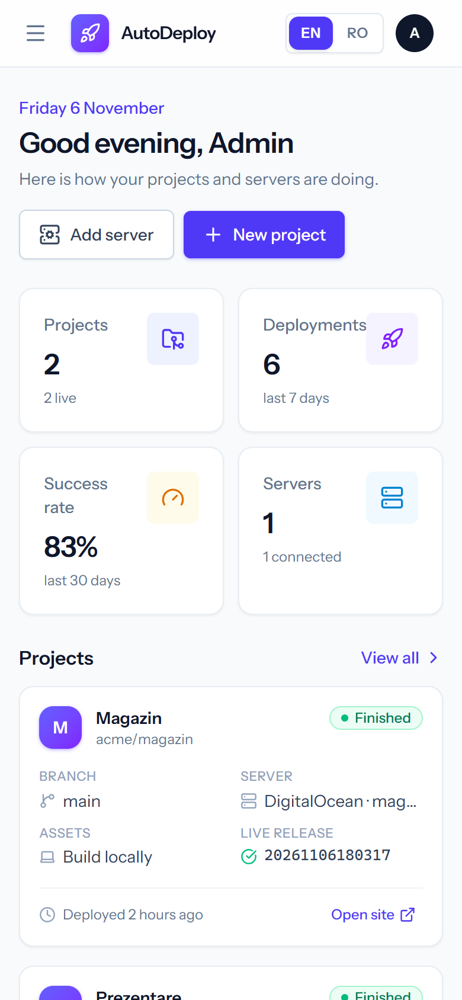
  &nbsp;&nbsp;
  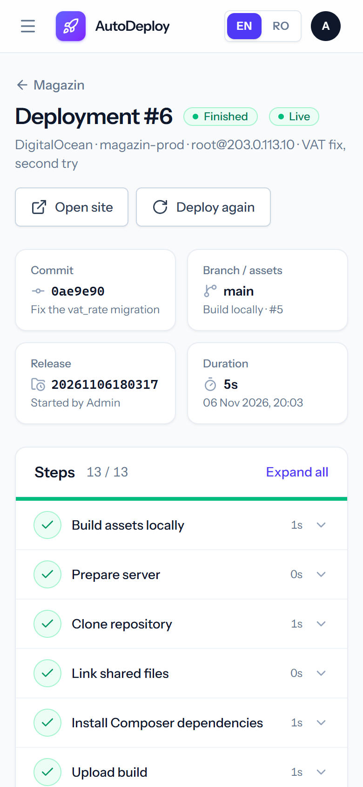
</p>

## Requirements

**On the computer that runs AutoDeploy** (usually your Windows PC):

| What           | Version                                                      | Notes                                                                                 |
| -------------- | ------------------------------------------------------------ | ------------------------------------------------------------------------------------- |
| PHP            | 8.3+ (tested with 8.5)                                       | with XAMPP: `C:\xampp\php` or `C:\xampp\php_<version>`, picked through `.php-version` |
| PHP extensions | `openssl`, `pdo_sqlite`, `sodium`, `zip`, `phar`, `mbstring` | enabled by default in XAMPP 8.5                                                       |
| Composer       | 2.x                                                          |                                                                                       |
| Node.js        | 22+                                                          | for the interface and for the local builds of your projects                           |
| Git            | recent                                                       | the local build reads the commit of the project folder                                |

The database is **SQLite** (`database/database.sqlite`): no MySQL server needed, and it does not mix with
other projects.

**On the server you deploy to** (Ubuntu / Debian or another Linux): SSH access, `git`, `php`, `composer`,
`tar`; optionally `node`/`npm` (only to build on the server) and `supervisor` (AutoDeploy can install it
from the Workers page).

## Installation

### Windows – the quick way

```bash
git clone https://github.com/BranDavidIonel/AutoDeploy.git
```

0. Optional, before the setup: copy `.env.example` to `.env` and put your admin email and password in
   `AUTODEPLOY_ADMIN_EMAIL` / `AUTODEPLOY_ADMIN_PASSWORD`. `.env` never goes into git.
1. Double-click **`setup-autodeploy.bat`** (first time only). It runs `composer install`, creates `.env`
   from `.env.example`, `php artisan key:generate`, the SQLite database + migrations + the admin user,
   `npm install` and `npm run build`. Safe to run again.
2. Double-click **`start-autodeploy.bat`**. It starts the web server and, in a minimized window, the
   **queue worker** that actually runs the deployments, then opens <http://127.0.0.1:8077>.
3. Log in with the admin email and password from `.env` (`AUTODEPLOY_ADMIN_EMAIL`,
   `AUTODEPLOY_ADMIN_PASSWORD`). With an empty password the setup creates a random one and prints it once.

> If the queue worker is not running, deployments stay "Queued" and the app shows a yellow warning
> with the command to start it.

### Manual (any system)

```bash
composer install
cp .env.example .env
php artisan key:generate
touch database/database.sqlite
php artisan migrate --seed
npm install
npm run build
```

Start it (two terminals):

```bash
php artisan serve --host=127.0.0.1 --port=8077
```

```bash
php artisan queue:work --timeout=3600 --tries=1
```

For development (server + queue + Vite hot reload + logs):

```bash
composer dev
```

### On a Linux server (optional, later)

AutoDeploy can also run on the server itself (a server of type "This machine" then runs the commands
directly, without SSH, and the GitHub webhook becomes useful). The steps (web server, Supervisor worker for
the queue) are in [docs/02-instalare-si-pornire.md](docs/02-instalare-si-pornire.md) (Romanian). Put the app
behind an extra login: it can run commands as root on the server.

## Configuration

### The `.env` file

Besides the usual Laravel settings, these matter:

| Variable                         | Default                 | What it does                                                                                    |
| -------------------------------- | ----------------------- | ----------------------------------------------------------------------------------------------- |
| `APP_URL`                        | `http://127.0.0.1:8077` | address of the app                                                                              |
| `APP_LOCALE`                     | `en`                    | default interface language; every user can switch it in the top bar (EN / RO)                   |
| `APP_KEY`                        | made at install         | encrypts the server secrets (pasted keys, passwords); if you change it, enter them again        |
| `DB_CONNECTION`                  | `sqlite`                | MySQL works too (`DB_HOST`, `DB_DATABASE`…)                                                     |
| `QUEUE_CONNECTION`               | `database`              | deployments run in the queue                                                                    |
| `DB_QUEUE_RETRY_AFTER`           | `4000`                  | **must be longer than a deploy** (seconds), otherwise the queue may start the same deploy twice |
| `AUTODEPLOY_LOCAL_SHELL`         | empty                   | bash for "This machine" servers; empty = `/bin/bash` on Linux, Git Bash on Windows              |
| `AUTODEPLOY_CONNECT_TIMEOUT`     | `20`                    | seconds to wait for the SSH connection                                                          |
| `AUTODEPLOY_COMMAND_TIMEOUT`     | `3600`                  | longest a command may run on the server                                                         |
| `AUTODEPLOY_LOCAL_BUILD_TIMEOUT` | `1800`                  | longest a local `npm run build` may run                                                         |
| `AUTODEPLOY_MAX_UPLOAD_MB`       | `200`                   | largest build archive you can upload (PHP's `upload_max_filesize` / `post_max_size` apply too)  |
| `AUTODEPLOY_ADMIN_EMAIL`         | `admin@example.com`     | email of the admin account made by `php artisan db:seed`                                        |
| `AUTODEPLOY_ADMIN_PASSWORD`      | empty                   | its password; empty = a random one is made and printed once. Keep it in `.env` only             |

### The admin account

The user is created by `database/seeders/DatabaseSeeder.php` (`php artisan db:seed`) with the email and
password from `.env`: `AUTODEPLOY_ADMIN_EMAIL` and `AUTODEPLOY_ADMIN_PASSWORD`. Credentials are never in the
code or in git. Without a password in `.env`, the seeder creates a random one and prints it once. After
logging in, change the password and email in **My account** (menu at the top right).

## First deploy, step by step

The example moves an existing site (e.g. `/var/www/my-site`) under AutoDeploy, without downtime.

### 1. Add the server (Servers → Add server)

| Field              | Example                                        | Notes                                                                                   |
| ------------------ | ---------------------------------------------- | --------------------------------------------------------------------------------------- |
| Type               | Remote server (SSH)                            | "This machine" only when AutoDeploy is installed on the server itself                   |
| Host / Port / User | `203.0.113.10` / `22` / `root`                 | a user that can write to the deploy folder and reload PHP-FPM                           |
| Log in with        | Key file on this computer: `~/.ssh/id_ed25519` | the key is not copied into AutoDeploy; alternatives: pasted key or password (encrypted) |

On save AutoDeploy connects and reads the system, RAM, disk and versions (PHP, Composer, Node, Git,
Apache/Nginx, MySQL, Supervisor). The first connection saves the server's **host key fingerprint**; if it
changes later, the connection is refused (protection against a fake server).

The server page shows the **server's public SSH key** (or a button that creates one). Add it in GitHub →
repository → _Settings → Deploy keys_ (read only), so the server can clone.

### 2. Create the project (Projects → New project)

| Field                   | Example                                    | Notes                                                                                      |
| ----------------------- | ------------------------------------------ | ------------------------------------------------------------------------------------------ |
| Repository / Branch     | `git@github.com:user/my-site.git` / `main` |                                                                                            |
| Deploy folder           | `/var/www/my-site-app`                     | a **new** folder; AutoDeploy creates `releases/`, `shared/` and `current` inside it        |
| PHP / Composer binary   | `php` / `composer`                         | or full paths, e.g. `php8.4` or `/usr/local/bin/php8.4 /usr/local/bin/composer`            |
| Web server user         | `www-data`                                 | gets `storage/` and `bootstrap/cache` after a deploy (the PHP-FPM pool user)               |
| Releases to keep        | `3`                                        | how many versions stay for rollback                                                        |
| Front-end build         | Build locally                              | the project folder on your PC (e.g. `C:\Users\dev\Desktop\work\my-site`) + `npm run build` |
| Build output folder     | `public/build`                             | where Vite writes the assets                                                               |
| Shared folders / files  | `storage` / `.env`                         | kept between releases                                                                      |
| Health check (optional) | `https://example.com/up`                   | requested after the release goes live                                                      |

The project gets the standard Laravel commands automatically (see step 7).

### 3. Quick setup (Quick setup tab)

The checklist shows what the server is missing (folders, `.env`, `APP_KEY`, repository access, web server,
Supervisor, web user, Node), each with how to fix it. Fill in **"Import .env and storage from an existing
folder"** with `/var/www/my-site` and press **Run quick setup**: it creates the structure, copies `.env` and
`storage/` into `shared/` once (`storage/` with hard links when possible: instant, no extra disk space), trusts
the `github.com` host key and checks repository access.

### 4. Check `.env` (Environment tab)

You edit `shared/.env` right on the server; the previous version stays in `.env.backup`. There are buttons
for "Generate APP_KEY" and a Laravel production template.

### 5. Deploy

The **Deploy** button opens the options: where the assets come from, which saved build, the branch and a
note. The deployment page shows the steps with a live log; you can cancel or, when it ends, deploy again.

### 6. Web server – once, after the first deploy

AutoDeploy detects whether the server uses **Apache** or **Nginx** and shows the matching config on the
Quick setup page.

**Apache** (with PHP-FPM): change only `DocumentRoot` and `<Directory>`, in both files of the site (the
http one and the `-le-ssl.conf` made by certbot). `SetHandler` (the PHP-FPM socket) stays the same.

```apache
DocumentRoot /var/www/my-site-app/current/public

<Directory /var/www/my-site-app/current/public>
    Options FollowSymLinks
    AllowOverride All
    Require all granted
</Directory>
```

```bash
sudo apachectl configtest && sudo systemctl reload apache2
```

**Nginx:**

```nginx
root /var/www/my-site-app/current/public;

location ~ ^/index\.php(/|$) {
    fastcgi_pass unix:/var/run/php/php8.4-fpm.sock;
    include fastcgi_params;
    # PHP sees the real release folder, so OPcache never serves the old release
    fastcgi_param SCRIPT_FILENAME $realpath_root$fastcgi_script_name;
    fastcgi_param DOCUMENT_ROOT $realpath_root;
}
```

```bash
sudo nginx -t && sudo systemctl reload nginx
```

The "Reload PHP-FPM" command of the deploy script finds the service by itself (`php8.4-fpm`, `php84-fpm`
or `php-fpm`) and clears OPcache after every deploy. The full config, with your site name, is on the Quick
setup page. The old folder stays as a backup.

### 7. Custom commands (Deploy script tab)

| Stage             | When it runs                                    | Default                                       |
| ----------------- | ----------------------------------------------- | --------------------------------------------- |
| Before build      | after `composer install`                        | –                                             |
| Before going live | in the new release, before it becomes `current` | `migrate --force`, `storage:link`, `optimize` |
| After going live  | right after the switch (and after a rollback)   | `queue:restart`, PHP-FPM reload               |

Commands run with `bash` and `set -e` in the new release folder. Available variables: `$PHP`,
`$COMPOSER_BIN`, `$RELEASE_PATH`, `$SHARED_PATH`, `$CURRENT_PATH`, `$DEPLOY_PATH`, `$RELEASE`, `$BRANCH`,
`$COMMIT`, `$WEB_USER`. A command that fails before the switch stops the deploy and the site stays on the
previous version. Commands run as the SSH user; after the "After going live" ones, `storage/` and
`bootstrap/cache` are given back to the web server user (automatic "Fix storage permissions" step).

### 8. Workers and scheduler (Workers tab)

**Set up queue workers** – one button: installs Supervisor when missing, creates the "Default queue" worker
(`php artisan queue:work`, as `www-data`) and starts it. For every worker you get start / stop / restart,
logs, editing and the generated Supervisor config. The **scheduler** (cron for `schedule:run`) is also one
click.

### 9. Saved build (Builds tab)

On your PC, in the project:

```bash
npm run build
```

Zip the contents of `public/build` (PowerShell):

```powershell
Compress-Archive -Path public\build\* -DestinationPath build.zip
```

Drop `build.zip` on the Builds page; optionally add the commit it was built from (then exactly that commit
is deployed) and tick "Deploy right after upload".

### 10. Rollback and webhook

- **Releases** → "Roll back to this": `current` switches instantly to the chosen release, then the "After
  going live" commands run. Database migrations are not reverted.
- **Settings** → "Deploy on git push": put the webhook URL in GitHub → _Settings → Webhooks_
  (`application/json`, the _push_ event). It only works when AutoDeploy is reachable from the internet.

## Layout on the server

```text
/var/www/my-site-app/
├── current -> releases/20261106183000   ← Apache / Nginx serves current/public
├── releases/                            ← the last N deploys (for rollback)
│   ├── 20261105120000/
│   └── 20261106183000/                  ← the live release
│       ├── .env -> ../../shared/.env
│       ├── storage -> ../../shared/storage
│       └── public/build/                ← the assets
└── shared/
    ├── .env
    └── storage/                         ← uploads, logs, sessions
```

## Useful commands and tests

```bash
php artisan test          # Pest tests (they never touch a server: the SSH connection is faked)
composer test             # tests + Pint + Larastan
npm run types:check       # TypeScript check
npm run check             # format + lint (Vite+)
npm run build             # the interface in public/build
```

## Full documentation

The detailed documentation is in [`docs/`](docs/README.md) (in Romanian):

1. [How it works](docs/01-cum-functioneaza.md) – concepts, what happens during a deploy, rollback
2. [Installation and start](docs/02-instalare-si-pornire.md) – Windows, manual, on a Linux server
3. [User guide](docs/03-ghid-de-utilizare.md) – every page, step by step
4. [Code architecture](docs/04-arhitectura.md) – for developers
5. [Tests](docs/05-teste.md) – the automated tests and the end-to-end test
6. [Troubleshooting](docs/06-probleme-frecvente.md) – common errors and fixes
