# AutoDeploy

[English](README.md) | **Română**

Aplicație de deploy pentru proiecte Laravel pe servere proprii (DigitalOcean sau orice Linux cu SSH),
în stilul Envoyer / DeployBot. E făcută pentru servere cu puțin RAM: build-ul de front-end
(`npm run build`) se poate face pe PC și doar rezultatul se urcă pe server. După un upgrade de RAM
treci build-ul pe server dintr-o setare.

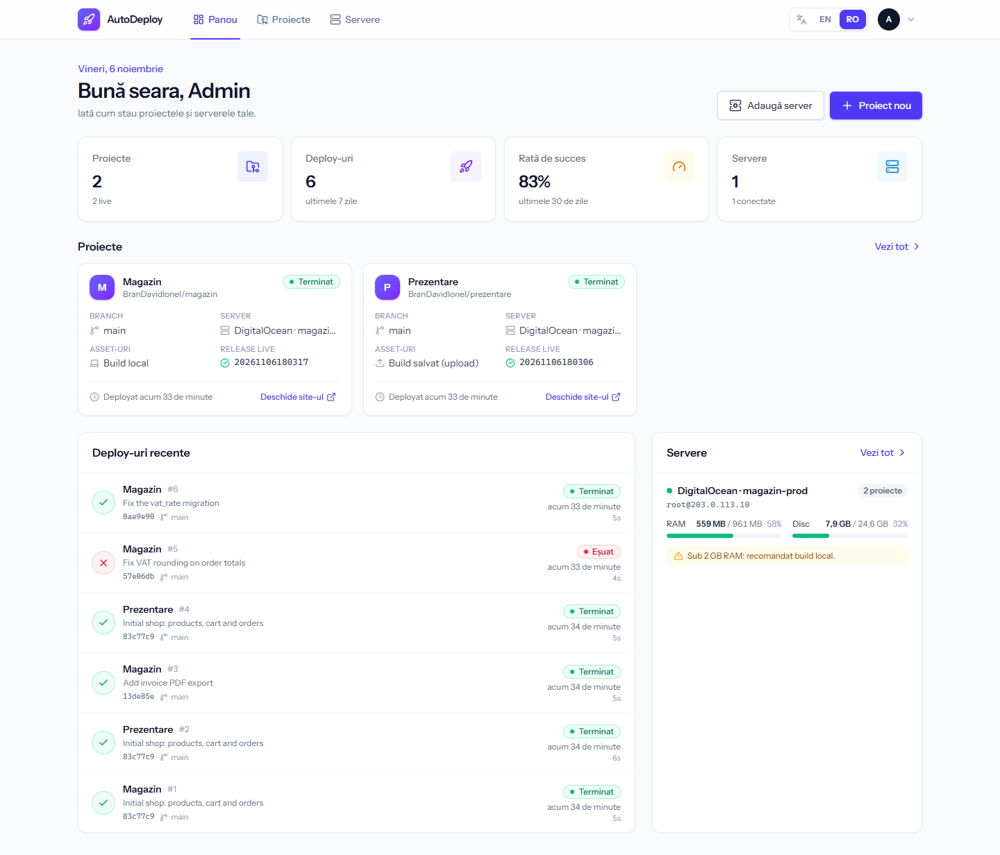

## Cuprins

- [Ce face](#ce-face)
- [Capturi de ecran](#capturi-de-ecran)
- [Cerințe](#cerințe)
- [Instalare](#instalare)
- [Configurare](#configurare)
- [Primul deploy, pas cu pas](#primul-deploy-pas-cu-pas)
- [Structura de pe server](#structura-de-pe-server)
- [Comenzi utile și teste](#comenzi-utile-și-teste)
- [Documentație completă](#documentație-completă)

## Ce face

- **Deploy fără downtime** – fiecare deploy într-un folder nou `releases/<data-ora>`, `.env` și
  `storage` comune în `shared/`, trecere instantanee pe versiunea nouă prin link-ul `current`. Dacă un
  pas eșuează, site-ul rămâne neatins pe versiunea veche.
- **3 variante pentru asset-uri**, alese per proiect și la fiecare deploy:
    - **Build local** – AutoDeploy rulează `npm run build` în folderul proiectului de pe PC și urcă rezultatul
      (folderul trebuie să fie commit-uit și push-uit: modificările necomise sau un commit ne-push-uit opresc deploy-ul);
    - **Build salvat** – urci un `.zip` cu `public/build` făcut deja; se păstrează ultimele N;
    - **Build pe server** – `npm ci && npm run build` pe server (după upgrade de RAM).
- **Rollback** dintr-un click la oricare din ultimele N release-uri (implicit 3).
- **Comenzi custom** (Laravel, npm, bash) în trei momente ale deploy-ului, cu presetări: migrări,
  `storage:link`, `optimize`, `queue:restart`, reload PHP-FPM, Horizon, Filament etc.
- **Log live** pentru fiecare pas, anulare, redeploy, health check, deploy la `git push` (webhook GitHub).
- **Workeri de coadă (Supervisor)** și **scheduler (cron)** configurate dintr-un singur buton.
- **Quick setup** al proiectului pe server: verificări + import `.env` și `storage` dintr-un site existent.
- **Editor `.env`** direct pe server, informații despre server (RAM, disc, versiuni), cheie SSH pentru GitHub.
- Interfață în **engleză și română** – limba se alege din bara de sus (implicit engleză).

**Stack:** Laravel 13 · Inertia 3 · Vue 3.5 + TypeScript · Tailwind CSS 4 · Wayfinder · phpseclib 3
(SSH/SFTP în PHP, merge și pe Windows) · Pest 5 · SQLite – aceleași versiuni ca proiectul ERP demo.

## Capturi de ecran

Capturile folosesc date demo (server și proiecte de exemplu).

|                 Pagina proiectului                 |               Opțiunile de deploy               |
| :------------------------------------------------: | :---------------------------------------------: |
|        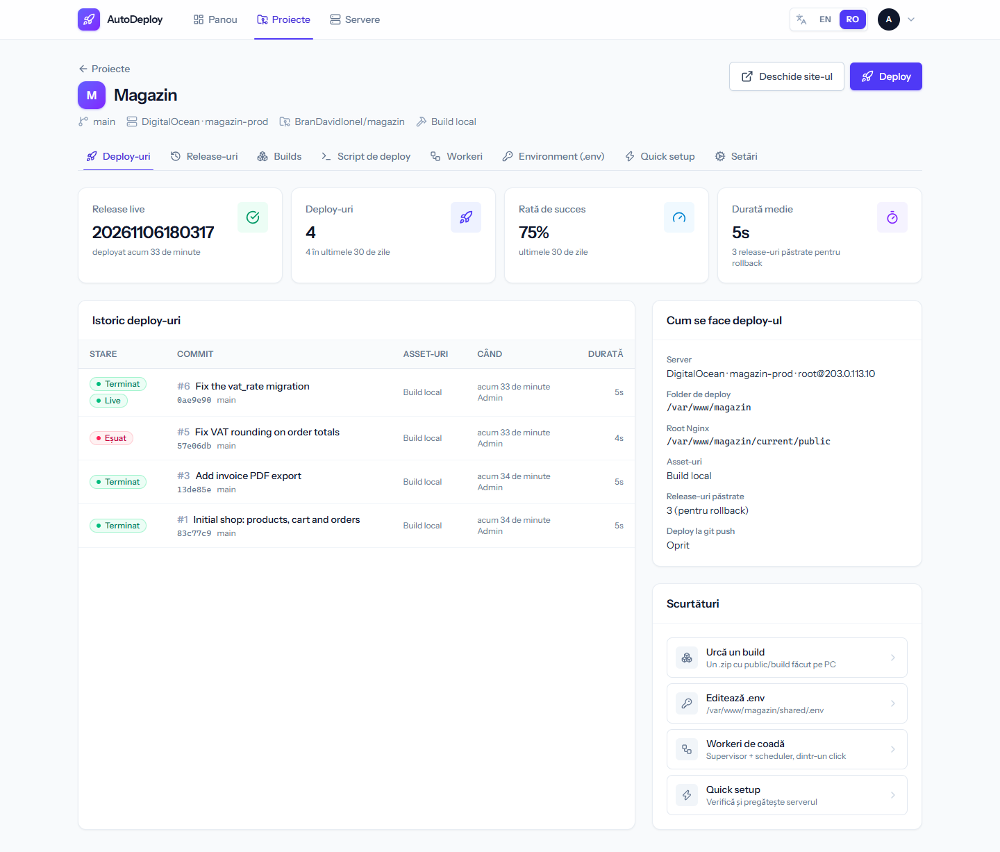         |    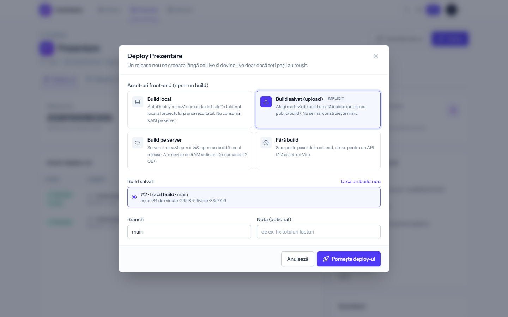    |
|               **Deploy cu log live**               | **Deploy oprit la o migrare – site-ul neatins** |
|     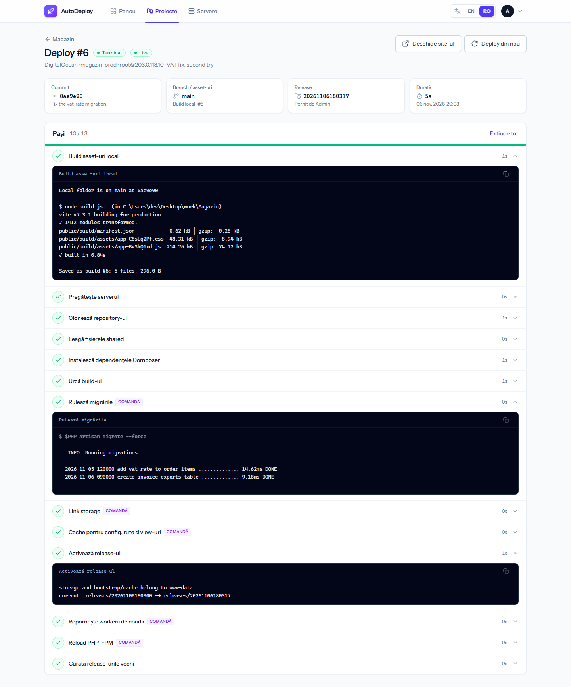      |  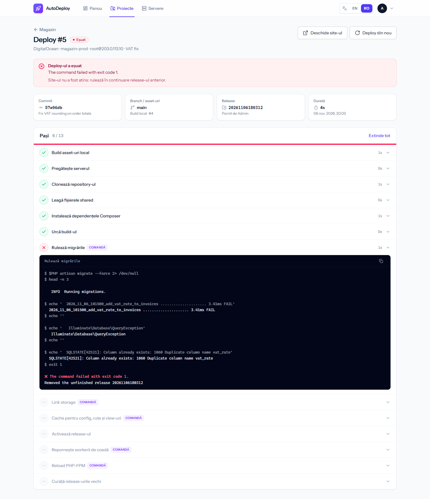  |
|      **Scriptul de deploy (comenzi custom)**       |        **Workeri de coadă și scheduler**        |
| 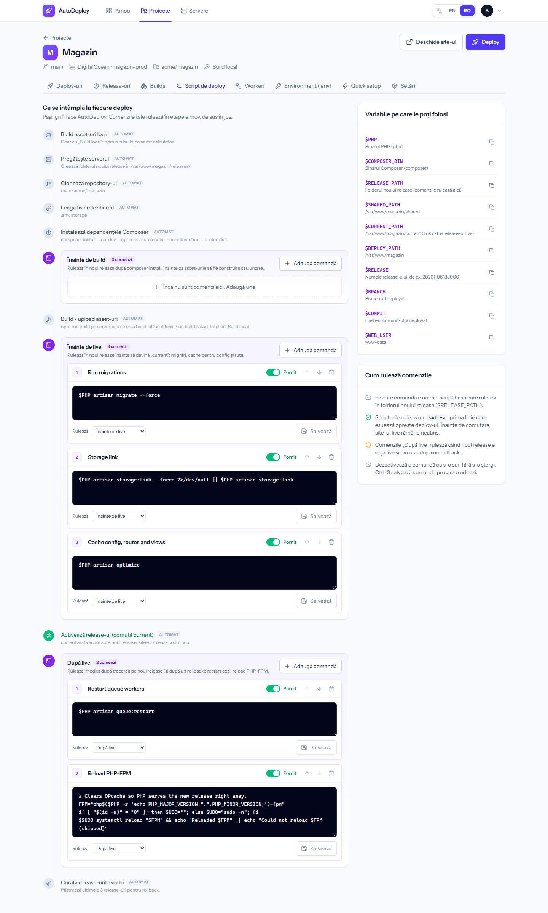 |       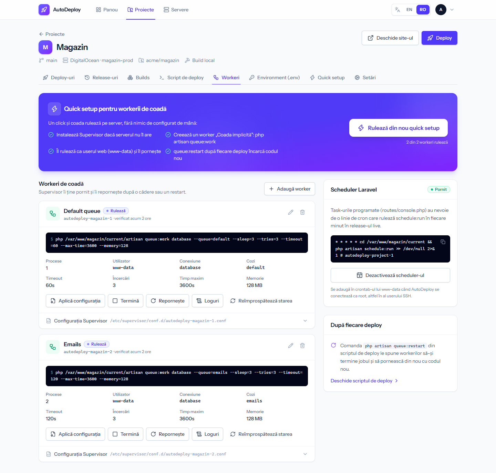       |
|            **Release-uri și rollback**             |         **Build-uri salvate (upload)**          |
|    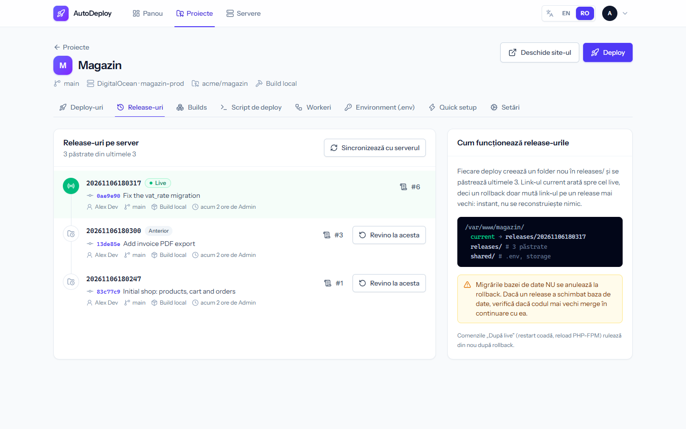     |        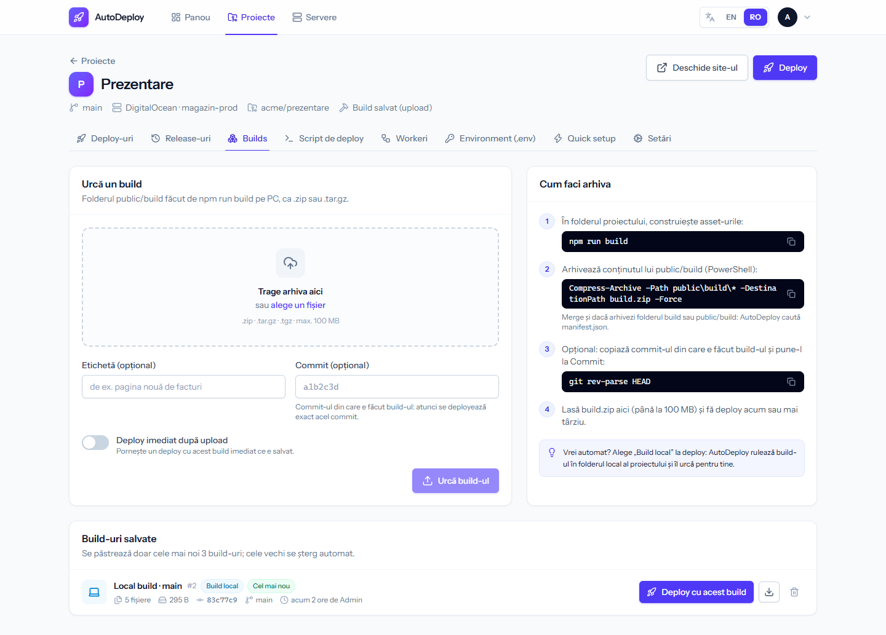        |
|      **Serverul: RAM, disc, programe, chei**       |                **Autentificare**                |
|         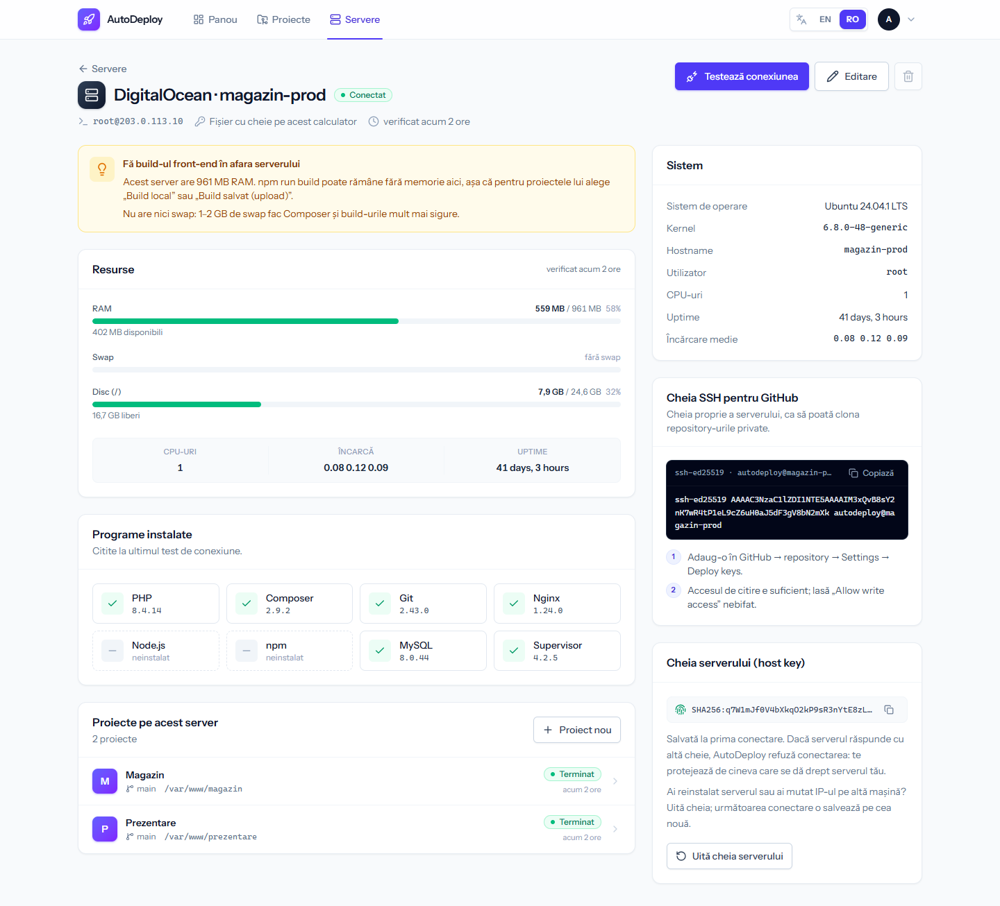          |         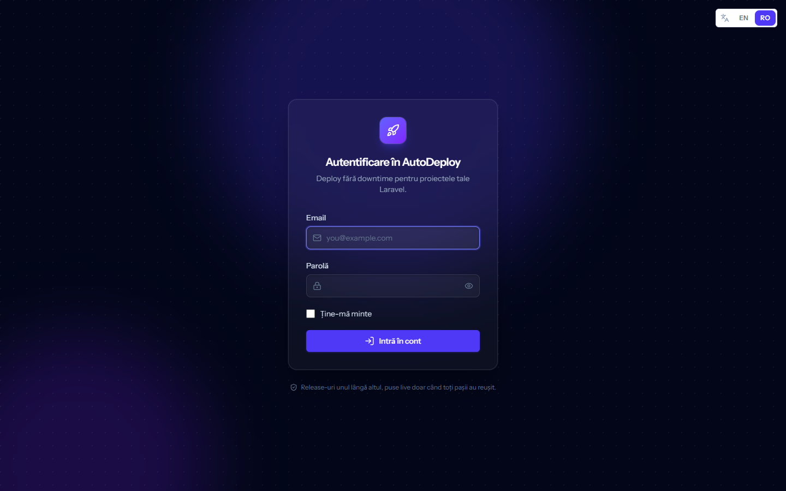         |

Pe telefon:

<p>
  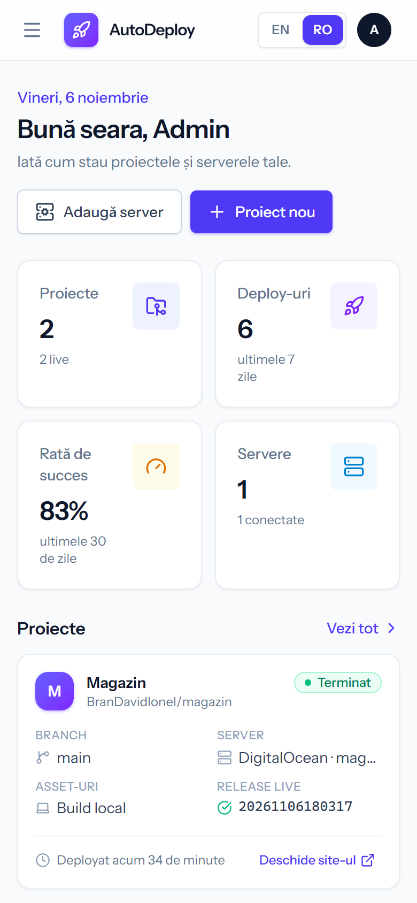
  &nbsp;&nbsp;
  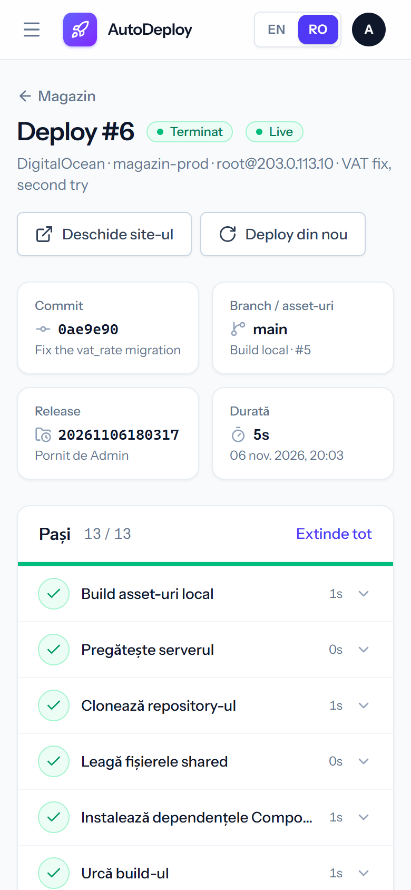
</p>

## Cerințe

**Pe calculatorul care rulează AutoDeploy** (de obicei PC-ul tău cu Windows):

| Ce           | Versiune                                                     | Observații                                                                       |
| ------------ | ------------------------------------------------------------ | -------------------------------------------------------------------------------- |
| PHP          | 8.3+ (testat cu 8.5)                                         | cu XAMPP: `C:\xampp\php` sau `C:\xampp\php_<versiune>`, ales după `.php-version` |
| Extensii PHP | `openssl`, `pdo_sqlite`, `sodium`, `zip`, `phar`, `mbstring` | active implicit în XAMPP 8.5                                                     |
| Composer     | 2.x                                                          |                                                                                  |
| Node.js      | 22+                                                          | pentru interfață și pentru build-urile locale ale proiectelor                    |
| Git          | recent                                                       | build-ul local citește commit-ul din folderul proiectului                        |

Baza de date e **SQLite** (`database/database.sqlite`): nu are nevoie de MySQL pornit și nu se
amestecă cu alte proiecte.

**Pe serverul pe care faci deploy** (Ubuntu / Debian sau alt Linux): acces SSH, `git`, `php`,
`composer`, `tar`; opțional `node`/`npm` (doar pentru build pe server) și `supervisor` (îl poate instala
AutoDeploy din pagina Workeri).

## Instalare

### Windows – varianta rapidă

```bash
git clone https://github.com/BranDavidIonel/AutoDeploy.git
```

0. Opțional, înainte de setup: copiază `.env.example` în `.env` și pune emailul și parola ta de admin la
   `AUTODEPLOY_ADMIN_EMAIL` / `AUTODEPLOY_ADMIN_PASSWORD`. `.env` nu ajunge niciodată pe git.
1. Dublu-click pe **`setup-autodeploy.bat`** (doar prima dată). Face: `composer install`, `.env` din
   `.env.example`, `php artisan key:generate`, baza SQLite + migrări + userul admin, `npm install`,
   `npm run build`. Poate fi rulat de mai multe ori.
2. Dublu-click pe **`start-autodeploy.bat`**. Pornește serverul web și, într-o fereastră minimizată,
   **workerul de coadă** care rulează efectiv deploy-urile; deschide <http://127.0.0.1:8077>.
3. Autentificare cu emailul și parola de admin din `.env` (`AUTODEPLOY_ADMIN_EMAIL`,
   `AUTODEPLOY_ADMIN_PASSWORD`). Dacă parola e goală, setup-ul creează una aleatoare și o afișează o
   singură dată.

> Dacă workerul de coadă nu rulează, deploy-urile rămân „În coadă" și aplicația afișează un
> avertisment galben cu comanda de pornire.

### Manual (orice sistem)

```bash
composer install
cp .env.example .env
php artisan key:generate
touch database/database.sqlite
php artisan migrate --seed
npm install
npm run build
```

Pornire (două terminale):

```bash
php artisan serve --host=127.0.0.1 --port=8077
```

```bash
php artisan queue:work --timeout=3600 --tries=1
```

Pentru dezvoltare (server + coadă + Vite cu hot reload + loguri):

```bash
composer dev
```

### Pe un server Linux (opțional, pe viitor)

AutoDeploy poate rula și pe server (atunci un server de tip „Acest calculator" rulează comenzile direct,
fără SSH, iar webhook-ul GitHub devine util). Pașii (Nginx, worker Supervisor pentru coadă) sunt în
[docs/02-instalare-si-pornire.md](docs/02-instalare-si-pornire.md#instalare-pe-un-server-linux-opțional-pe-viitor).
Pune aplicația în spatele unei autentificări suplimentare: poate rula comenzi ca root pe server.

## Configurare

### Fișierul `.env`

Pe lângă setările obișnuite Laravel, contează:

| Variabilă                        | Implicit                | Ce face                                                                                                             |
| -------------------------------- | ----------------------- | ------------------------------------------------------------------------------------------------------------------- |
| `APP_URL`                        | `http://127.0.0.1:8077` | adresa aplicației                                                                                                   |
| `APP_LOCALE`                     | `en`                    | limba implicită a interfeței; fiecare utilizator o schimbă din bara de sus (EN / RO)                                |
| `APP_KEY`                        | generată la instalare   | criptează secretele serverelor (chei lipite, parole); dacă o schimbi, le reintroduci                                |
| `DB_CONNECTION`                  | `sqlite`                | merge și cu MySQL (`DB_HOST`, `DB_DATABASE`…)                                                                       |
| `QUEUE_CONNECTION`               | `database`              | deploy-urile rulează în coadă                                                                                       |
| `DB_QUEUE_RETRY_AFTER`           | `4000`                  | **trebuie să fie mai mare decât durata unui deploy** (secunde), altfel coada poate porni același deploy de două ori |
| `AUTODEPLOY_LOCAL_SHELL`         | gol                     | bash-ul pentru servere „Acest calculator"; gol = `/bin/bash` pe Linux, Git Bash pe Windows                          |
| `AUTODEPLOY_CONNECT_TIMEOUT`     | `20`                    | secunde de așteptare la conectarea SSH                                                                              |
| `AUTODEPLOY_COMMAND_TIMEOUT`     | `3600`                  | durata maximă a unei comenzi pe server                                                                              |
| `AUTODEPLOY_LOCAL_BUILD_TIMEOUT` | `1800`                  | durata maximă a unui `npm run build` local                                                                          |
| `AUTODEPLOY_MAX_UPLOAD_MB`       | `200`                   | mărimea maximă a unei arhive de build urcate (contează și `upload_max_filesize` / `post_max_size` din `php.ini`)    |
| `AUTODEPLOY_ADMIN_EMAIL`         | `admin@example.com`     | emailul contului de admin creat de `php artisan db:seed`                                                            |
| `AUTODEPLOY_ADMIN_PASSWORD`      | gol                     | parola lui; gol = se generează una aleatoare, afișată o singură dată. Ține-o doar în `.env`                         |

### Contul de admin

Userul e creat de `database/seeders/DatabaseSeeder.php` (`php artisan db:seed`) cu emailul și parola din
`.env`: `AUTODEPLOY_ADMIN_EMAIL` și `AUTODEPLOY_ADMIN_PASSWORD`. Credențialele nu sunt niciodată în cod sau
în git. Fără parolă în `.env`, seeder-ul creează una aleatoare și o afișează o singură dată. După login,
parola și emailul se schimbă din **Contul meu** (meniul din dreapta sus).

## Primul deploy, pas cu pas

Exemplul mută un site existent (ex. `/var/www/my-site`) sub AutoDeploy, fără downtime.
Denumirile de mai jos sunt cele din interfața în română.

### 1. Adaugă serverul (Servere → Adaugă server)

| Câmp               | Exemplu                                                  | Observații                                                                               |
| ------------------ | -------------------------------------------------------- | ---------------------------------------------------------------------------------------- |
| Tip                | Server remote (SSH)                                      | „Acest calculator" doar când AutoDeploy e instalat chiar pe server                       |
| Host / Port / User | `203.0.113.10` / `22` / `root`                           | un user care poate scrie în folderul de deploy și da reload la PHP-FPM                   |
| Autentificare      | Fișier cu cheie pe acest calculator: `~/.ssh/id_ed25519` | cheia nu se copiază în AutoDeploy; alternativ: cheie lipită sau parolă (salvate criptat) |

La salvare AutoDeploy se conectează și citește sistemul, RAM-ul, discul și versiunile (PHP, Composer,
Node, Git, Nginx, MySQL, Supervisor). La prima conectare salvează **amprenta cheii serverului**; dacă se
schimbă, conectarea e refuzată (protecție împotriva unui server fals).

Pe pagina serverului apare **cheia SSH publică a serverului** (sau butonul care o creează). Adaug-o în
GitHub → repository → _Settings → Deploy keys_ (doar citire), ca serverul să poată clona.

### 2. Creează proiectul (Proiecte → Proiect nou)

| Câmp                              | Exemplu                                    | Observații                                                                               |
| --------------------------------- | ------------------------------------------ | ---------------------------------------------------------------------------------------- |
| Repository / Branch               | `git@github.com:user/my-site.git` / `main` |                                                                                          |
| Folder de deploy                  | `/var/www/my-site-app`                     | un folder **nou**; AutoDeploy creează în el `releases/`, `shared/`, `current`            |
| Binarul PHP / Composer            | `php` / `composer`                         | sau căi complete, ex. `php8.4`                                                           |
| Userul serverului web             | `www-data`                                 | primește `storage/` și `bootstrap/cache` după deploy                                     |
| Release-uri păstrate              | `3`                                        | câte versiuni rămân pentru rollback                                                      |
| Build front-end                   | Build local                                | folderul proiectului de pe PC (ex. `C:\Users\tu\Desktop\work\my-site`) + `npm run build` |
| Folderul cu rezultatul build-ului | `public/build`                             | unde scrie Vite asset-urile                                                              |
| Foldere / fișiere shared          | `storage` / `.env`                         | păstrate între release-uri                                                               |
| Health check (opțional)           | `https://site.ro/up`                       | accesat după ce release-ul devine live                                                   |

Proiectul primește automat comenzile Laravel standard (vezi pasul 6).

### 3. Quick setup (tab-ul Quick setup)

Lista de verificări arată ce lipsește pe server (folderul, `.env`, `APP_KEY`, accesul la repository,
Nginx, Supervisor, userul web, Node), fiecare cu explicația cum se repară. Completează **„Importă .env și
storage dintr-un folder existent"** cu `/var/www/my-site` și apasă **Rulează quick setup**: se creează
structura, se copiază o singură dată `.env` și `storage/` în `shared/` (`storage/` cu hard link-uri când se
poate: instant, fără spațiu în plus pe disc), se acceptă cheia `github.com` și se verifică accesul la
repository.

### 4. Verifică `.env` (tab-ul Environment)

Editezi direct `shared/.env` de pe server; versiunea anterioară rămâne în `.env.backup`. Ai butoane pentru
„Generează APP_KEY" și un șablon Laravel de producție.

### 5. Deploy

Butonul **Deploy** deschide opțiunile: de unde vin asset-urile, ce build salvat, branch-ul și o notă.
Pagina deploy-ului arată pașii cu log live; poți anula sau, după terminare, face deploy din nou.

### 6. Serverul web – o singură dată, după primul deploy

AutoDeploy detectează singur dacă serverul folosește **Apache** sau **Nginx** și îți arată configurația
potrivită pe pagina Quick setup.

**Apache** (cu PHP-FPM): schimbi doar `DocumentRoot` și `<Directory>`, în ambele fișiere ale site-ului
(cel pentru http și `-le-ssl.conf`, făcut de certbot). `SetHandler` (socket-ul PHP-FPM) rămâne neschimbat.

```apache
DocumentRoot /var/www/my-site-app/current/public

<Directory /var/www/my-site-app/current/public>
    Options FollowSymLinks
    AllowOverride All
    Require all granted
</Directory>
```

```bash
sudo apachectl configtest && sudo systemctl reload apache2
```

**Nginx:**

```nginx
root /var/www/my-site-app/current/public;

location ~ ^/index\.php(/|$) {
    fastcgi_pass unix:/var/run/php/php8.4-fpm.sock;
    include fastcgi_params;
    # PHP vede folderul real al release-ului, deci OPcache nu servește release-ul vechi
    fastcgi_param SCRIPT_FILENAME $realpath_root$fastcgi_script_name;
    fastcgi_param DOCUMENT_ROOT $realpath_root;
}
```

```bash
sudo nginx -t && sudo systemctl reload nginx
```

Comanda „Reload PHP-FPM" din scriptul de deploy găsește singură serviciul (`php8.4-fpm`, `php84-fpm` sau `php-fpm`) și golește OPcache după fiecare deploy. Configurația completă, cu numele site-ului tău, e pe pagina Quick setup. Folderul vechi rămâne ca backup.

### 7. Comenzile custom (tab-ul Script de deploy)

| Etapă            | Când rulează                                 | Implicit                                      |
| ---------------- | -------------------------------------------- | --------------------------------------------- |
| Înainte de build | după `composer install`                      | –                                             |
| Înainte de live  | în noul release, înainte să devină `current` | `migrate --force`, `storage:link`, `optimize` |
| După live        | imediat după activare (și la rollback)       | `queue:restart`, reload PHP-FPM               |

Comenzile rulează cu `bash` și `set -e` în folderul noului release. Variabile disponibile: `$PHP`,
`$COMPOSER_BIN`, `$RELEASE_PATH`, `$SHARED_PATH`, `$CURRENT_PATH`, `$DEPLOY_PATH`, `$RELEASE`, `$BRANCH`,
`$COMMIT`, `$WEB_USER`. O comandă care eșuează înainte de activare oprește deploy-ul, iar site-ul rămâne
pe versiunea veche. Comenzile rulează ca userul SSH; după cele „După live", `storage/` și `bootstrap/cache`
sunt date din nou userului serverului web (pasul automat „Fix storage permissions").

### 8. Workeri și scheduler (tab-ul Workeri)

**Configurează workerii de coadă** – un buton: instalează Supervisor dacă lipsește, creează workerul
„Coada implicită" (`php artisan queue:work`, ca `www-data`) și îl pornește. Pentru fiecare worker ai
start / stop / restart, loguri, editare și configurația Supervisor generată. **Scheduler-ul** (cron pentru
`schedule:run`) se activează tot dintr-un click.

### 9. Build salvat (tab-ul Builds)

Pe PC, în proiect:

```bash
npm run build
```

Arhivează conținutul lui `public/build` (PowerShell):

```powershell
Compress-Archive -Path public\build\* -DestinationPath build.zip
```

Trage `build.zip` în pagina Builds; opțional pui commit-ul din care e făcut (atunci se deployează exact
acel commit) și bifezi „Deploy imediat după upload".

### 10. Rollback și webhook

- **Release-uri** → „Revino la acesta": `current` trece instant pe release-ul ales, apoi rulează comenzile
  „După live". Migrările bazei de date nu se anulează.
- **Setări** → „Deploy la git push": URL-ul de webhook se pune în GitHub → _Settings → Webhooks_
  (`application/json`, evenimentul _push_). Merge doar dacă AutoDeploy e accesibil din internet.

## Structura de pe server

```text
/var/www/my-site-app/
├── current -> releases/20261106183000   ← Apache / Nginx servește current/public
├── releases/                            ← ultimele N deploy-uri (pentru rollback)
│   ├── 20261105120000/
│   └── 20261106183000/                  ← release-ul live
│       ├── .env -> ../../shared/.env
│       ├── storage -> ../../shared/storage
│       └── public/build/                ← asset-urile
└── shared/
    ├── .env
    └── storage/                         ← upload-uri, loguri, sesiuni
```

## Comenzi utile și teste

```bash
php artisan test          # testele Pest (nu ating niciun server: conexiunea SSH e simulată)
composer test             # teste + Pint + Larastan
npm run types:check       # verificare TypeScript
npm run check             # format + lint (Vite+)
npm run build             # interfața în public/build
```

## Documentație completă

Totul, în detaliu, în [`docs/`](docs/README.md):

1. [Cum funcționează](docs/01-cum-functioneaza.md) – conceptele, ce se întâmplă la un deploy, rollback
2. [Instalare și pornire](docs/02-instalare-si-pornire.md) – Windows, manual, pe un server Linux
3. [Ghid de utilizare](docs/03-ghid-de-utilizare.md) – toate paginile, pas cu pas
4. [Arhitectura codului](docs/04-arhitectura.md) – pentru developeri
5. [Teste](docs/05-teste.md) – testele automate și testul end-to-end
6. [Probleme frecvente](docs/06-probleme-frecvente.md) – erori des întâlnite și soluții
