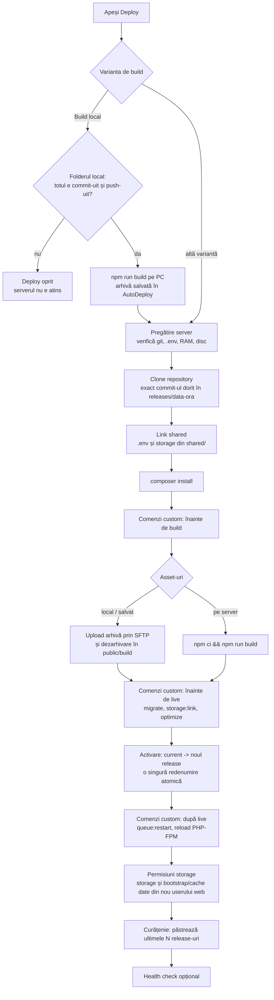

# 01 – Cum funcționează AutoDeploy

## Problema pe care o rezolvă

Serverul de pe DigitalOcean are puțin RAM. `npm run build` (Vite) are nevoie de mult mai multă
memorie decât aplicația în sine, așa că pe server build-ul eșuează sau blochează site-urile.
Până acum: build pe PC, apoi upload manual al folderului `public/build` pe server, plus
`git pull`, `composer install`, `php artisan migrate` etc. de mână.

AutoDeploy face toți acești pași automat, în ordine, cu log live, fără downtime și cu
posibilitatea de a reveni la versiunea anterioară dintr-un click. Iar pentru partea de
front-end ai trei variante, pe care le schimbi oricând (de exemplu după ce mărești RAM-ul):

| Varianta            | Ce face                                                                                             | Când o folosești                                       |
| ------------------- | --------------------------------------------------------------------------------------------------- | ------------------------------------------------------ |
| **Build local**     | AutoDeploy rulează `npm run build` în folderul proiectului de pe PC-ul tău și urcă rezultatul       | acum, cât serverul are puțin RAM (implicit)            |
| **Build salvat**    | urci tu un `.zip` cu `public/build` făcut deja pe PC; AutoDeploy îl păstrează și îl poate re-folosi | când ai deja build-ul, sau rulezi AutoDeploy pe server |
| **Build pe server** | serverul rulează `npm ci && npm run build` în noul release                                          | după ce mărești RAM-ul (2 GB+)                         |
| **Fără build**      | sare peste front-end                                                                                | API-uri fără Vite                                      |

## Concepte

- **Server** – o mașină la care AutoDeploy se conectează prin SSH (cheie, ex. `~/.ssh/id_ed25519`,
  sau parolă). Poate fi și „Acest calculator", când AutoDeploy e instalat chiar pe server.
- **Proiect** – un site Laravel: repository git + branch, folderul de pe server, varianta de build,
  comenzile custom, workerii.
- **Deploy** – o rulare a pipeline-ului. Are pași (steps), fiecare cu log-ul lui.
- **Release** – un folder `releases/<data-ora>` pe server, creat de un deploy. Se păstrează ultimele
  N (implicit 3) pentru rollback.
- **Build salvat** – o arhivă cu conținutul lui `public/build`, păstrată în AutoDeploy
  (`storage/app/private/builds`). Se păstrează ultimele N (implicit 3).
- **Comenzi custom (hooks)** – comenzi bash (Laravel, npm, orice) care rulează în anumite momente
  ale deploy-ului. Proiectele noi primesc automat: migrate, storage:link, optimize,
  queue:restart, reload PHP-FPM.
- **Worker** – `php artisan queue:work` ținut pornit de Supervisor pe server. Se configurează dintr-un
  buton („Quick setup").

## Structura de pe server

AutoDeploy folosește structura clasică de deploy fără downtime (la fel ca Envoyer / Deployer):

```text
/var/www/aplicatia-mea/              ← "Deploy folder" din setările proiectului
├── current -> releases/20261106183000   ← link către versiunea live; Apache / Nginx servește current/public
├── releases/
│   ├── 20261105120000/             ← release vechi (pentru rollback)
│   ├── 20261106101500/
│   └── 20261106183000/             ← release-ul live
│       ├── .env -> ../../shared/.env
│       ├── storage -> ../../shared/storage
│       ├── vendor/                  ← composer install
│       └── public/build/            ← asset-urile (build local / salvat / pe server)
├── shared/
│   ├── .env                         ← același pentru toate release-urile
│   └── storage/                     ← upload-uri, loguri, sesiuni – nu se pierd la deploy
└── .autodeploy/                     ← arhive temporare la upload
```

Serverul web trebuie să servească `/var/www/aplicatia-mea/current/public` (Apache: `DocumentRoot`, Nginx: `root`). Pagina „Quick setup" a
proiectului îți dă configurația completă.

## Ce se întâmplă la un deploy



Reguli importante:

1. **Site-ul nu e atins până la pasul „Activare".** Tot ce e înainte se face într-un folder nou. Dacă
   un pas eșuează (ex. `composer install`, o migrare), deploy-ul se oprește, folderul neterminat se
   șterge și site-ul rămâne pe versiunea veche.
2. **Activarea e instantanee**: `ln -sfn` pe un link temporar + `mv -T` (redenumire atomică). Nu
   există moment în care site-ul să fie pe jumătate actualizat.
3. **Build local = exact același commit**: AutoDeploy citește commit-ul din folderul local
   (`git rev-parse HEAD`) și pe server face checkout fix la acel commit. Codul și asset-urile se
   potrivesc. De aceea, înainte de build, AutoDeploy verifică folderul local:
    - **modificări necomise** (fișiere urmărite de git) → deploy-ul se oprește și arată primele fișiere
      modificate: asset-urile ar fi construite din ele, dar serverul ar primi codul din ultimul commit;
    - **commit ne-_push_-uit** → după `git fetch origin <branch>`, dacă commit-ul nu e pe
      `origin/<branch>` (branch-ul deploy-ului sau cel local), deploy-ul se oprește cu mesajul să faci
      `git push`;
    - dacă `git fetch` nu merge (offline, fără acces la repository), apare doar un avertisment și
      deploy-ul continuă; dacă commit-ul chiar lipsește, pasul „Clone" de pe server eșuează, iar site-ul
      rămâne neatins.
4. **Un singur deploy pe proiect odată.** Al doilea e refuzat cât primul rulează.
5. **Deploy-urile rulează în fundal** (coada Laravel), într-un `queue:work`. Nu trebuie pornit de mână:
   când un deploy intră în coadă și nu rulează niciun worker, AutoDeploy pornește singur unul în fundal
   (`php artisan queue:work database --stop-when-empty --timeout=3600 --tries=1 --sleep=1`, fără
   fereastră), care se oprește când coada e goală. Merge și când AutoDeploy e servit de Apache (XAMPP).
   Fiecare worker scrie în cache un „heartbeat" (la câteva secunde, iar cât rulează un deploy, pe toată
   durata lui), așa că un worker pornit de `start-autodeploy.bat` sau de Supervisor e recunoscut și nu
   se mai pornește altul lângă el. Output-ul workerului pornit automat e în
   `storage/logs/queue-worker.log`; pornirea automată se oprește cu `AUTODEPLOY_AUTO_WORKER=false`.
   Pagina deploy-ului se actualizează singură la 1,5 secunde (log live).
6. **Permisiunile lui `storage`**: comenzile custom rulează ca userul SSH (de multe ori `root`). Dacă
   proiectul are un „User web" (ex. `www-data`), `storage/` și `bootstrap/cache` îi sunt date la
   activare și, dacă există comenzi „după live", din nou după ele (pasul „Fix storage permissions"):
   de exemplu `queue:restart` scrie în cache și poate crea foldere ale lui `root`, pe care PHP-FPM nu
   le-ar mai putea scrie.

## Rollback

Pe tab-ul **Releases** vezi release-urile încă prezente pe server. „Revino la acesta" înseamnă:

1. verificare că folderul există;
2. `current` mutat pe acel release (instant);
3. comenzile „după live" (queue:restart, reload PHP-FPM);
4. permisiunile lui `storage` date din nou userului web (dacă e setat și există comenzi „după live");
5. health check, dacă e setat.

Atenție: rollback-ul **nu** anulează migrările de bază de date. Dacă un deploy a schimbat structura
bazei de date într-un mod incompatibil cu codul vechi, trebuie rezolvat manual.

## Workeri și scheduler

- **Quick setup worker**: instalează Supervisor dacă lipsește (`apt-get install supervisor`, ca root),
  creează un worker „Default queue" (`php artisan queue:work database`) care rulează ca `www-data`,
  scrie `/etc/supervisor/conf.d/autodeploy-<proiect>-<id>.conf` și îl pornește. Comanda rulează în
  `current/`, deci după fiecare deploy `queue:restart` îl face să pornească pe noul cod.
- **Scheduler**: o linie în crontab (a userului `www-data` când ești root) care rulează
  `php artisan schedule:run` în fiecare minut, marcată cu `# autodeploy-project-<id>` ca să poată fi
  scoasă curat.

## Unde rulează AutoDeploy

- **Pe PC-ul tău (Windows)** – varianta recomandată acum: are acces la folderele proiectelor tale
  pentru build local și la cheia ta SSH. Se pornește cu `start-autodeploy.bat` sau e servit de Apache-ul
  din XAMPP (workerul de coadă pornește singur, vezi mai sus).
- **Pe server (Linux)** – după upgrade-ul de RAM, poți instala AutoDeploy și pe server; atunci un
  server de tip „Acest calculator" rulează comenzile direct, fără SSH, iar webhook-ul GitHub
  (deploy la `git push`) devine util, pentru că serverul e accesibil din internet.
