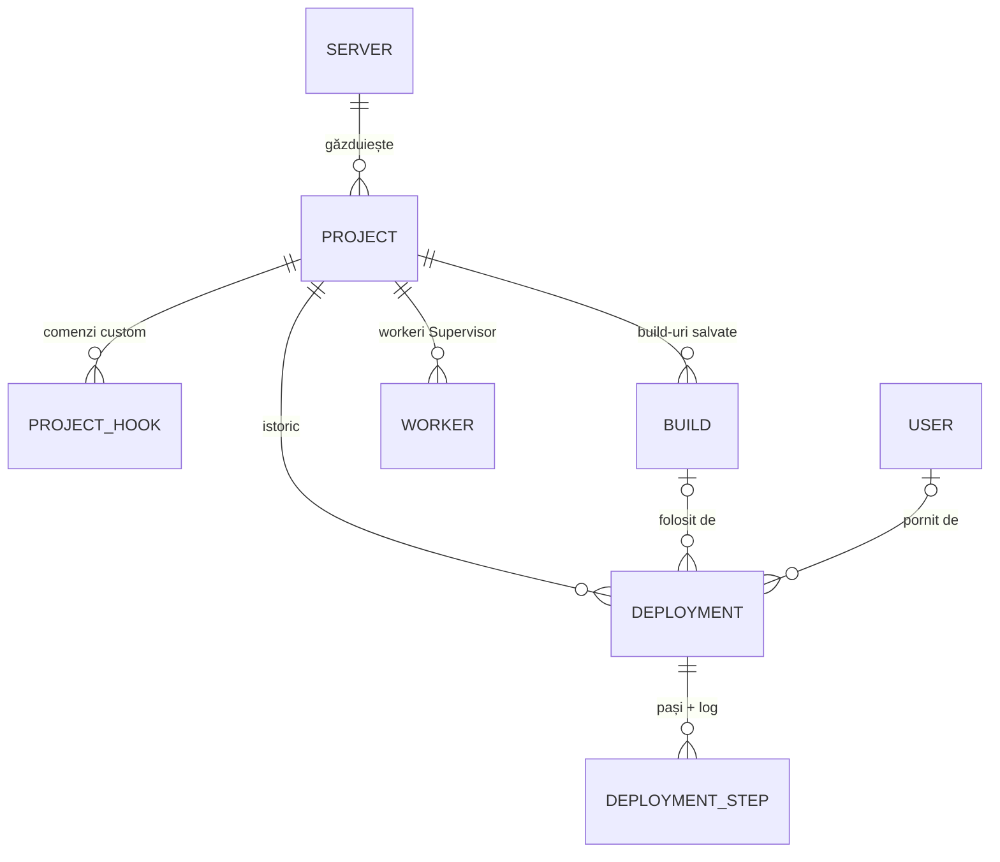

# 04 – Arhitectura codului (pentru developeri)

## Stack

Aceleași versiuni și convenții ca la proiectul ERP demo (pornit din `laravel/blank-vue-starter-kit`):

- **Laravel 13**, PHP 8.5 (minim 8.3), SQLite, coadă `database`;
- **Inertia 3** + **Vue 3.5** cu **TypeScript**, componente în stilul **Options API**
  (`defineComponent({ props, data, computed, methods })`);
- **Tailwind CSS 4**, iconițe **Lucide** (`@lucide/vue`), **Vite+** (`vp build`);
- **Wayfinder** – rutele Laravel ca funcții TypeScript (`resources/js/routes`, `resources/js/actions`,
  generate automat, ignorate de git);
- **phpseclib 3** – SSH și SFTP în PHP pur (merge pe Windows fără `ssh.exe`);
- **Pest 5** pentru teste, Pint pentru stil PHP, Larastan.

## Structura

```text
app/
├── Enums/                     BuildStrategy, DeploymentStatus, StepStatus, HookStage, ...
├── Exceptions/                DeployException (mesaj pentru user), DeploymentCancelled
├── Http/
│   ├── Controllers/           Dashboard, Server, Project, Deployment, Webhook, Account, Auth/Login
│   │   └── Projects/          tab-urile unui proiect: Release, Build, Hook, Worker, Environment, Setup
│   │                          + ProjectPage (props comune tuturor tab-urilor)
│   ├── Requests/              validare: ServerRequest, ProjectRequest, HookRequest, WorkerRequest
│   ├── Resources/             forma datelor trimise la Vue (= tipurile din resources/js/types/models.ts)
│   └── Middleware/            HandleInertiaRequests (props globale), SetLocale (RO/EN), SecurityHeaders
├── Jobs/RunDeployment.php     jobul din coadă care rulează un deploy
├── Models/                    Server, Project, ProjectHook, Deployment, DeploymentStep, Build, Worker, User
└── Services/
    ├── Remote/                Connection (interfață), SshConnection, LocalConnection, ConnectionFactory, Shell
    ├── Deploy/                DeploymentPlanner, DeploymentRunner, DeployScripts, StepOutput,
    │                          LocalBuilder, BuildStorage, HookPresets
    ├── Servers/ServerInspector.php     test conexiune + info server + generare cheie SSH
    ├── Projects/ProjectSetup.php       quick setup (verificări + pregătire)
    ├── Projects/EnvironmentFile.php    citire / scriere shared/.env
    └── Workers/                SupervisorConfig, WorkerManager, SchedulerManager
config/autodeploy.php          limbile, timeout-urile, shell-ul local, limita de upload
resources/js/
├── pages/                     o pagină Inertia per ecran (Dashboard, servers/*, projects/*, deployments/Show, ...)
├── layouts/                   AppLayout (bara de sus, toasts, fereastra de output), AuthLayout (login)
├── components/                buttons, inputs, modals, general (LogOutput, StatusBadge, ...),
│                              modules/projects (ProjectShell, DeployModal, ...), modules/servers
├── i18n/                      $t('text') – traducerile din lang/ro.json (aceeași sursă ca __() din PHP)
├── types/                     models.ts (tipurile datelor), global.d.ts (props globale, flash)
└── utils/                     ansi.ts (log colorat), format.ts (date, durate, mărimi), navigation.ts
lang/ro.json                   traducerile românești (cheia = textul englezesc)
tests/                         Pest: Feature/*, Unit/*, Support/FakeConnection.php
```

## Modelul de date



- `servers` – conexiunea (ssh / local), metoda de autentificare; `private_key`, `passphrase`, `password`
  sunt **criptate** (cast `encrypted`); `host_fingerprint` (TOFU); `info` (JSON cu RAM, disc, versiuni).
- `projects` – repository, branch, `deploy_path`, binare, `build_strategy`, `local_path`, comenzile de
  build, `shared_dirs` / `shared_files` (JSON), `web_user`, `keep_releases`, `keep_builds`,
  `webhook_token`, `active_release` (ce e live).
- `project_hooks` – `stage` (`before_build` / `before_activate` / `after_activate`), `script`, `enabled`, `sort`.
- `deployments` – `type` (deploy / rollback), `status`, commit, `release`, `build_source`, `build_id`,
  `release_exists` (folderul e încă pe server → rollback posibil), `cancel_requested`, `error`.
- `deployment_steps` – `key` (`prepare`, `clone`, `hook:12`, ...), `status`, `output` (log), `script`
  (copie a comenzii custom de la momentul deploy-ului).
- `builds` – arhivele `.tar.gz` din `storage/app/private/builds/{proiect}/`.
- `workers` – parametrii `queue:work` + ultima stare citită din `supervisorctl status`.

## Motorul de deploy

1. **`DeploymentPlanner`** (apelat din controller / webhook) verifică dacă se poate porni (nu rulează
   alt deploy, există build-ul ales, există folderul local), creează `Deployment` + **toți pașii**
   (`pending`, ca pagina să-i arate imediat) și pune `RunDeployment` în coadă. Tot el face
   `rollback()` și `redeploy()`.
2. **`RunDeployment`** (job, `tries = 1`, `timeout = 3600`) apelează `DeploymentRunner`; dacă workerul
   moare, `failed()` marchează deploy-ul ca eșuat ca să nu rămână „running" la nesfârșit.
3. **`DeploymentRunner`** ia pașii pe rând. Pentru fiecare pas construiește scriptul bash cu
   **`DeployScripts`** și îl rulează prin `Connection::run()`; output-ul vine bucată cu bucată în
   **`StepOutput`**, care îl salvează în DB de ~2 ori pe secundă și verifică la 2 s dacă userul a cerut
   anularea (dacă da, callback-ul întoarce `true` și phpseclib închide canalul). La eroare: pasul curent
   `failed`, restul `skipped`, release-ul neactivat e șters, deploy-ul `failed` cu mesajul erorii.
4. **`DeployScripts`** e singurul loc cu bash-ul pipeline-ului: `prepare`, `clone` (doar commit-ul dorit,
   `git fetch --depth 1`), `shared`, `composer`, `hook`, `serverBuild`, `extractBuild`, `permissions`,
   `activate` (`ln -sfn` + `mv -Tf`), `cleanup`, `removeRelease`. `permissions` rulează în `activate` și
   încă o dată ca pas separat (`permissions`) după comenzile „după live" (deploy și rollback), doar când
   proiectul are `web_user` și cel puțin o astfel de comandă: ele rulează ca userul SSH și pot lăsa în
   `storage` fișiere pe care PHP-FPM nu le poate scrie. `wrap()` adaugă preambulul comun:
   `exec 2>&1`, nvm, `PATH`, `COMPOSER_ALLOW_SUPERUSER`, `GIT_SSH_COMMAND` cu
   `StrictHostKeyChecking=accept-new`, variabilele exportate și `set -e`.
   Scripturile scriu linii-marker (`__AUTODEPLOY_COMMIT__`, `__AUTODEPLOY_RELEASES__`) pe care runner-ul
   le citește; interfața le ascunde din log.
5. **`LocalBuilder`** (varianta „Build local") citește commit-ul/branch-ul cu git, rulează comanda de
   build cu Symfony Process în folderul local și salvează folderul de output prin **`BuildStorage`**
   (arhivă `.tar.gz` cu `PharData`, păstrează ultimele N). La upload pe server: SFTP + `tar -xzf`.
   Înainte de build oprește deploy-ul (`DeployException`) dacă `git status --porcelain
   --untracked-files=no` arată modificări sau dacă, după `git fetch origin <branch>` (fără prompt:
   `GIT_TERMINAL_PROMPT=0`, SSH cu `BatchMode=yes`), `git merge-base --is-ancestor` spune că commit-ul
   nu e pe `origin/<branch>`. Dacă fetch-ul eșuează (offline), doar avertizează.

> Variabila pentru Composer se numește `$COMPOSER_BIN`, nu `$COMPOSER`: Composer citește variabila de
> mediu `COMPOSER` ca nume al fișierului `composer.json` (bug găsit la testarea end-to-end).

## Conexiuni

`Connection` are 4 metode: `run(script, onOutput, timeout)`, `upload(local, remote)`,
`put(remote, contents)`, `close()`.

- **`SshConnection`** – phpseclib `SFTP` (extinde `SSH2`, deci aceeași conexiune face și `exec` și SFTP).
  Autentificare cu fișier de cheie (citit la fiecare conectare, `~` expandat), cheie lipită sau parolă.
  Verifică amprenta host key (salvată la prima conectare). Rulează `bash -c '<script>'`.
- **`LocalConnection`** – rulează bash local (Symfony Process). Pe Windows folosește Git Bash cu
  `MSYS=winsymlinks:sys`, ca `ln -s` să creeze link-uri fără drepturi de admin (util la teste).
- **`ConnectionFactory`** – singleton; testele îl înlocuiesc cu `fake()`.

## Frontend

- Fiecare pagină primește props din controller; tipurile sunt în `resources/js/types/models.ts`.
- Tab-urile unui proiect sunt pagini separate învelite în **`ProjectShell`** (antet, tab-uri, butonul
  Deploy + `DeployModal`, banner cu deploy-ul în curs). `ProjectPage::props()` din PHP le dă datele
  comune (`project`, `activeDeployment`, `deployOptions`).
- **Log live**: `deployments/Show` face `router.reload({ only: ['deployment', ...] })` la 1,5 s cât
  deploy-ul e activ; `LogOutput` transformă codurile ANSI în culori (`utils/ansi.ts`) și urmărește
  finalul log-ului.
- **Output de comenzi** (quick setup, workeri, scheduler): controllerul trimite
  `Inertia::flash('output', [...])`, iar `CommandOutputModal` (în `AppLayout`) îl afișează.
- **Props amânate**: `.env` și verificările din Quick setup sunt `Inertia::defer(...)` – pagina apare
  imediat, datele de pe server vin după.
- **Traduceri**: toate textele sunt în engleză în cod (`__('...')` în PHP, `$t('...')` în Vue) și
  traduse în `lang/ro.json`. Implicit `APP_LOCALE=en` (engleză); comutatorul EN/RO din bara de sus pune un cookie.

## Securitate

- Toată aplicația e în spatele login-ului (un singur admin, din seeder); login limitat la 5 încercări/min.
- Secretele serverelor sunt criptate cu `APP_KEY`; cheile din fișier nu se salvează deloc.
- TOFU pe host key: o schimbare a cheii serverului blochează conexiunea.
- Căile introduse (shared, build output) sunt validate ca relative, fără `..`; arhivele urcate sunt
  verificate contra „zip slip".
- Webhook-ul nu are CSRF (GitHub nu poate trimite token), dar URL-ul conține un token aleator de 48 de
  caractere, regenerabil; doar push-urile pe branch-ul proiectului pornesc deploy-uri.
- Toate valorile puse în scripturi trec prin `Shell::quote()` (ghilimele simple, escape corect).
  Comenzile custom sunt bash scris de admin – rulează exact cum sunt scrise.

## Cum adaugi ceva

- **Un pas nou în pipeline**: o metodă în `DeployScripts`, un `['cheie', __('Nume')]` în
  `DeploymentPlanner::deploySteps()` și un caz în `DeploymentRunner::runStep()`. Apoi un test.
- **O presetare de comandă**: un element în `HookPresets::all()` (cu `default: true` dacă vrei să apară
  la proiectele noi).
- **Un text nou în interfață**: scrie-l în engleză cu `$t()` / `__()` și adaugă traducerea în
  `lang/ro.json`.
